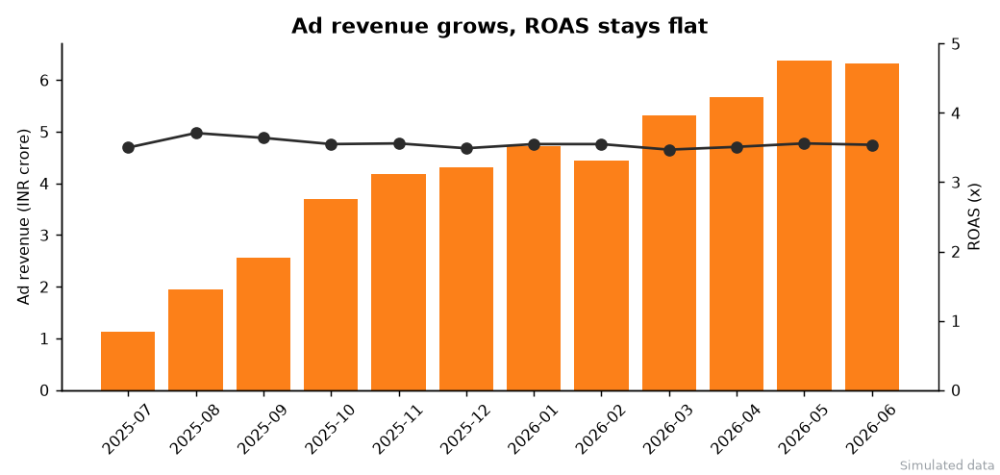
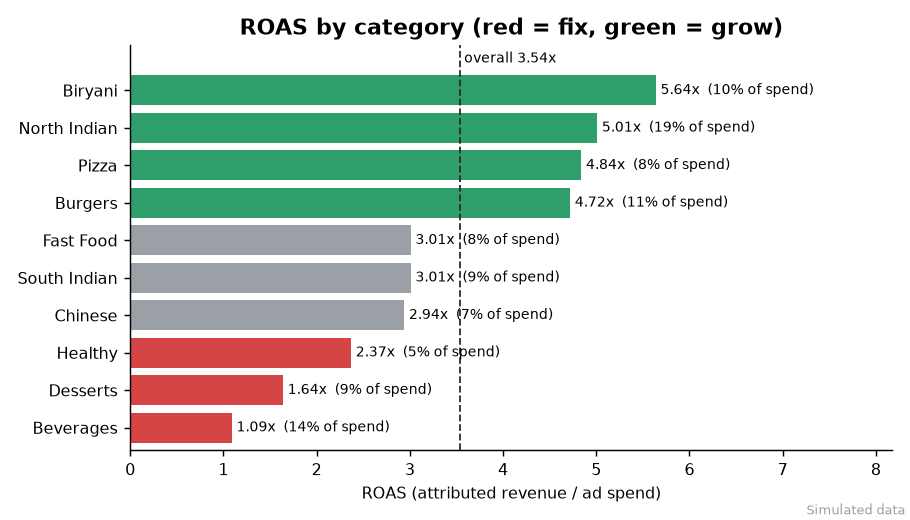
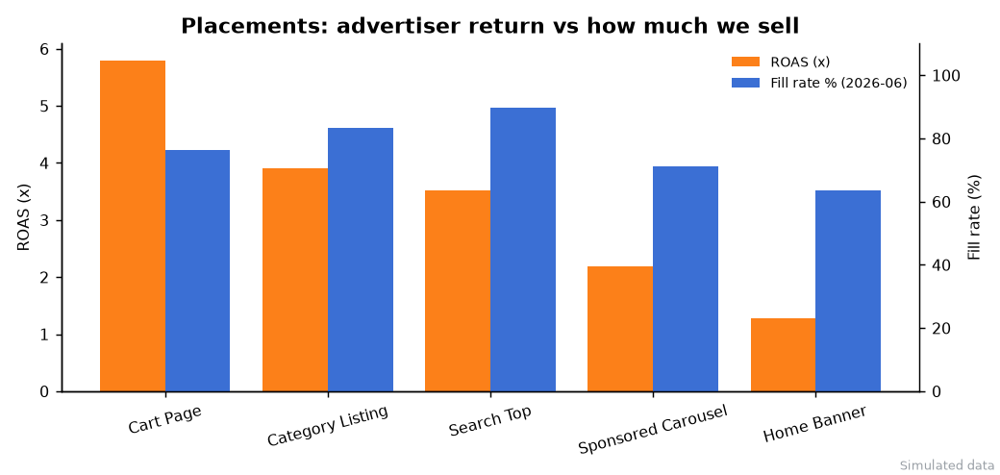
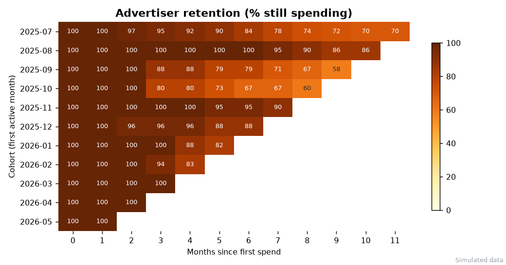
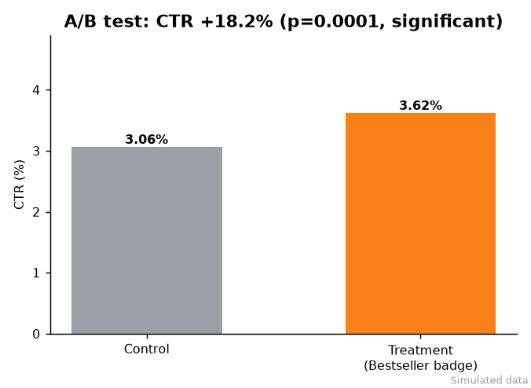

# FoodAds Analytics: Ads Marketplace Performance, Experimentation and Opportunity Sizing

An end-to-end business-analytics project on a **simulated food-delivery ads marketplace**, where restaurants (advertisers) buy ad placements on a delivery app.
It answers the questions an ads business analyst gets every week: *How is the ads P&L doing? Which categories and placements should we grow or fix? Did this A/B test win? How big is the prize before we build anything?*

> **Data disclaimer:** all data is **synthetic**, generated by `src/generate_data.py`. It is not real data from any company. The business patterns in it are planted on purpose (listed in [`docs/DATA_DICTIONARY.md`](docs/DATA_DICTIONARY.md)); the SQL, statistics and recommendations are real method applied to that data.



## What this project covers

| Business task | Where it lives | What it does |
|---|---|---|
| **Strategic analysis** of ad revenue, advertisers, inventory | `sql/01` to `sql/09` | 10 SQL analyses: KPIs, trends, category, placement, segments, retention, ranking |
| **KPI dashboard and metric definitions** | `outputs/dashboard.html`, [`docs/METRIC_DEFINITIONS.md`](docs/METRIC_DEFINITIONS.md) | Revenue, CTR, CPM, ROAS, fill rate, advertiser count, one definition each |
| **Experiment design and readout** | `src/ab_test.py` | A/B test on a new ad format: hypothesis, z-test, confidence intervals, power, guardrails, decision |
| **Opportunity sizing** | `src/opportunity_sizing.py` | Revenue upside from selling unsold inventory, three scenarios with explicit assumptions |
| **Advertiser and category insights** | `sql/03`, `sql/09`, [`docs/INSIGHTS_MEMO.md`](docs/INSIGHTS_MEMO.md) | Segments to grow or fix, with a stakeholder-ready memo |
| **Engineering hygiene** | `tests/`, `run_pipeline.py` | 13 automated tests, one-command reproducible pipeline |

## Quick start

Requires **Python 3.10+**. No database server needed (SQLite ships with Python).

```bash
# 1. get into the project folder
cd foodads-analytics

# 2. create and activate a virtual environment
python3 -m venv .venv
source .venv/bin/activate            # Windows (PowerShell): .venv\Scripts\Activate.ps1
                                     # Windows (cmd):        .venv\Scripts\activate.bat

# 3. install dependencies
pip install -r requirements.txt

# 4. run everything (about 5 seconds; uses the shipped dataset in data/)
python run_pipeline.py

# 5. open the dashboard
open outputs/dashboard.html          # macOS
xdg-open outputs/dashboard.html      # Linux
start outputs\dashboard.html         # Windows
```

Run the tests:

```bash
pytest -q          # 13 tests
```

## How to use it

### Run the whole pipeline
```bash
python run_pipeline.py                              # uses the shipped CSVs in data/ -> exactly the numbers in this README
python run_pipeline.py --regenerate                 # brand-new simulated data (seed 42, 300 advertisers)
python run_pipeline.py --regenerate --seed 7        # different random world
python run_pipeline.py --regenerate --advertisers 800   # bigger marketplace
```

### Run one step at a time
```bash
python -m src.generate_data --seed 42      # 1. create CSVs in data/
python -m src.load_db                      # 2. load them into data/foodads.db (SQLite)
python -m src.run_queries                  # 3. run sql/*.sql, write CSVs to outputs/tables/
python -m src.ab_test                      # 4. A/B readout -> outputs/reports/ab_test_readout.md
python -m src.opportunity_sizing           # 5. sizing -> outputs/reports/opportunity_sizing.md
python -m src.make_charts                  # 6. PNG charts -> outputs/charts/
python -m src.build_dashboard              # 7. outputs/dashboard.html
```

### Explore the data with your own SQL
```bash
sqlite3 data/foodads.db
```
```sql
-- ROAS by placement
SELECT c.placement,
       ROUND(SUM(attributed_revenue) / SUM(spend), 2) AS roas
FROM daily_performance dp JOIN campaigns c USING (campaign_id)
GROUP BY c.placement ORDER BY roas DESC;
```
Or open `data/foodads.db` in [DB Browser for SQLite](https://sqlitebrowser.org/) or the VS Code "SQLite Viewer" extension.

### Use the tables in Google Sheets or Looker Studio
Every SQL result is exported to `outputs/tables/*.csv`.
- **Google Sheets:** File > Import > Upload, pick a CSV, then build pivot tables and charts.
- **Looker Studio:** Create > Data source > File Upload (or upload to Sheets first and use the Google Sheets connector), then build a scorecard + trend + category bar chart from `02_monthly_trend.csv`, `03_category_performance.csv` and `04_placement_performance.csv`.

### Change the assumptions
- Planted business patterns: constants at the top of `src/generate_data.py`.
- FIX / GROW thresholds: `sql/09_segments_to_grow_or_fix.sql` and `src/config.py`.
- Opportunity scenarios (fill uplift, marginal-price discount): `SCENARIOS` in `src/opportunity_sizing.py`.

## Project structure

```
foodads-analytics/
├── run_pipeline.py            # one command to run everything
├── requirements.txt
├── src/
│   ├── config.py              # paths and thresholds
│   ├── generate_data.py       # simulated dataset (seeded, reproducible)
│   ├── load_db.py             # CSV -> SQLite with schema, keys, indexes
│   ├── run_queries.py         # runs every sql/*.sql, exports CSVs
│   ├── ab_test.py             # z-test, CI, power, decision rule, readout
│   ├── opportunity_sizing.py  # scenario model for inventory upside
│   ├── make_charts.py         # matplotlib charts
│   └── build_dashboard.py     # self-contained HTML dashboard
├── sql/                       # 10 analyses (see table below)
├── tests/test_pipeline.py     # data integrity, KPI formulas, statistics
├── docs/
│   ├── METRIC_DEFINITIONS.md  # every KPI defined once
│   ├── DATA_DICTIONARY.md     # tables, columns, planted patterns
│   └── INSIGHTS_MEMO.md       # one-page stakeholder memo
├── data/                      # shipped simulated CSVs (SQLite DB is created here on first run)
└── outputs/                   # tables/, charts/, reports/, dashboard.html
```

## Data model

```
advertisers 1───* campaigns 1───* daily_performance        inventory (date x placement)
 (category, tier, size)  (placement)   (impressions, clicks,          (capacity_impressions)
                                        orders, spend, revenue)
                                                              ab_test_users (variant, clicked, ordered)
```
About 300 advertisers, 450 campaigns, 86k campaign-days, 1B impressions over Jul 2025 to Jun 2026.

## SQL analyses

| File | Question | SQL techniques |
|---|---|---|
| `01_overall_kpis` | Headline ads P&L | joins, aggregates |
| `02_monthly_trend` | Growth: volume or price? | CTE, `LAG()` for MoM growth |
| `03_category_performance` | Which categories earn the best return? | `RANK()`, window `SUM() OVER ()` for share |
| `04_placement_performance` | Which ad slots work? | cost per click / order, ROAS |
| `05_inventory_fill_rate` | Where is inventory unsold or maxed out? | CTE, `LEFT JOIN`, conditional average |
| `06_advertiser_segments` | Size x city tier returns | multi-key grouping |
| `07_retention_cohorts` | How fast do advertisers drop off? | cohort analysis, month-diff arithmetic |
| `08_advertiser_ranking` | Which big advertisers are at risk? | `RANK() PARTITION BY`, `NTILE()` |
| `09_segments_to_grow_or_fix` | Where should we act? | `CROSS JOIN`, `CASE`, `HAVING` |
| `10_opportunity_inputs` | Inputs for sizing | date arithmetic, CTEs |

## Results (shipped dataset, seed 42)

| Headline KPI | Value |
|---|---|
| Ad revenue (advertiser spend) | INR 50.7 crore over 12 months |
| Impressions / CTR / CPM | 1.02 B / 3.57% / INR 499 |
| ROAS | 3.54x (flat all year) |
| Ad revenue growth | INR 1.1 cr (Jul 2025) to INR 6.3 cr (Jun 2026) |

**Key findings** (details in [`docs/INSIGHTS_MEMO.md`](docs/INSIGHTS_MEMO.md)):

1. **Returns vary 5x by category.** Biryani 5.6x and North Indian 5.0x vs Desserts 1.6x and Beverages 1.1x, driven by order value (INR 380 vs INR 140). Beverages is 14% of ad revenue.
2. **High CTR is not high return.** Beverages and Desserts click well but cost INR 116-129 per order vs INR 61-67 for Burgers and Biryani.
3. **Home Banner is the weak slot** (ROAS 1.3x, INR 265 per order, 64% fill). **Cart Page is the best** (ROAS 5.8x) and 24% unsold. Search Top is near capacity (90% fill), so price, not volume, is the lever.
4. **28% of ad revenue** sits in segments with ROAS below 70% of average (the "FIX" list).
5. **SMB advertisers churn most:** 31% vs 14% (Mid) and 3% (Chain).
6. **A/B test: ship the Bestseller badge.** CTR +18% (3.06% to 3.62%, p = 0.0001), orders per user +28% (p = 0.02), no drop in click-to-order.
7. **Opportunity:** raising fill rates by 3 / 6 / 10 pp adds roughly INR 0.4 / 0.8 / 1.5 crore per quarter (+2% / +4% / +8%), under explicit price-discount assumptions.

<p>


</p>
<p>


</p>

## A/B test method (short)

- **Hypothesis:** a "Bestseller" badge on the Sponsored Carousel raises CTR without hurting downstream conversion.
- **Metrics:** primary = CTR; secondary = orders per user; guardrails = click-to-order rate and revenue per user.
- **Tests:** two-proportion z-test (pooled SE for the p-value, unpooled SE for the 95% CI); Welch t-test for revenue per user. Alpha 5%, power target 80%.
- **Decision rule (coded in `ab_test.decide`):** SHIP if the primary metric wins and no guardrail worsens; RAMP CAUTIOUSLY if guardrails are negative but not significant; HOLD if a guardrail is significantly worse; DO NOT SHIP otherwise.
- The readout text is generated from the numbers, so it changes if you change the seed.

## Limitations (read this before quoting numbers)

- **Simulated data.** Findings show the analytical method, not facts about any real market.
- **Exact numbers depend on the shipped CSVs.** Random streams can differ between NumPy versions, so `--regenerate` on another machine gives the same structure and patterns but slightly different figures (for example the A/B CTR lift may be +17% instead of +18%). The numbers in this README and the memo match the CSVs in `data/`.
- **ROAS is not profit.** It is sales divided by ad spend; margins are not modelled.
- **Click-based attribution only**, with no view-through or halo effects.
- **Several metrics are tested in the A/B readout** without multiple-comparison correction.
- **Small segments** (for example Healthy x Tier-2, 4 advertisers) are noisy.
- **Retention cohort 2025-07** also contains advertisers that joined before the window opened.
- Opportunity sizing depends on assumed fill uplift and discount; validate with a pricing experiment before acting.

## Possible extensions

- Add a margin table to turn ROAS into contribution profit.
- Model auction dynamics (bid landscape, second-price) instead of fixed placement CPMs.
- CUPED variance reduction and sequential testing for the A/B analysis.
- Swap SQLite for Postgres and schedule the pipeline (cron / GitHub Actions).

## License

MIT. See [`LICENSE`](LICENSE).
# FoodAds-Analytics
