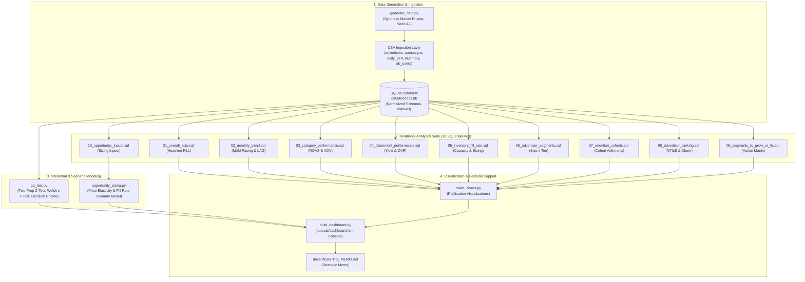

# FoodAds Intelligence: Marketplace Economics, Experimentation & Inventory Yield Optimization

[](https://www.python.org/)
[](LICENSE)
[](tests/)
[](#system-architecture)

An end-to-end, executive-grade business analytics platform modeling the unit economics, statistical experimentation, and inventory yield optimization of a high-volume **three-sided food delivery advertising marketplace** (analogous to Swiggy Ads, Zomato Ads, DoorDash, and Uber Eats).

This project goes beyond generic reporting to solve the fundamental questions confronted by ads marketplace leadership:
- **Ads P&L vs. Merchant Health:** *Why can platform ad revenue grow 5.6x (+472%) while masking severe merchant margin destruction in lower-order-value categories?*
- **Inventory Yield Economics:** *How do we allocate impression capacity between saturated high-intent slots (Search Top at 90% fill) and high-yield under-monetized slots (Cart Page at 5.8x ROAS with 24% unsold capacity)?*
- **Causal Experimentation:** *Did a new ad format (Bestseller Badge) generate genuine incrementality, or did it merely cannibalize downstream conversion?*
- **Opportunity Sizing:** *What is the defensible quarterly top-line upside of clearing unsold inventory under price elasticity discounts?*

---

## Executive Performance Matrix (12-Month Operating Window)

| Marketplace Metric | Value | Operational Context |
|---|---|---|
| **Platform Ad Revenue** | **₹50.68 Cr** ($506.8M INR) | Platform's top-line revenue from restaurant ad spend (July 2025 – June 2026). |
| **Attributed Consumer GMV** | **₹179.54 Cr** | Total food order value generated directly via sponsored ad clicks. |
| **Total Ad Impressions** | **1.02 Billion** | Volume delivered across 5 ad placements; average marketplace CPM = **₹499**. |
| **Marketplace Blended ROAS** | **3.54x** | Flat year-round (benchmark healthy: > 3.0x), but masks extreme category divides. |
| **Active Merchant Partners** | **300 Merchants** | Scaled from 115 active advertisers (Jul 2025) to 272 (Jun 2026). |
| **A/B Experiment Decision** | **SHIP TO PRODUCTION** | Treatment lifted CTR by **+18.2%** ($p = 0.0001$) with **zero guardrail degradation**. |
| **Quarterly Inventory Upside** | **+₹81.6 Lakhs** | Base case opportunity (+4.4% quarterly top-line uplift) from clearing unsold slots. |

> **Data Disclosure:** All data is synthesized via `src/generate_data.py` (seed 42). Real-world marketplace phenomena—such as basket-size margin traps, placement fatigue, intent decay, and SMB churn cliffs—are mathematically embedded. The analytical pipelines, SQL transforms, and statistical hypothesis engines represent production industry methodology.

---

## Modern Enterprise UI (Interactive Intelligence Console)

The platform generates a self-contained, responsive enterprise intelligence console (`outputs/dashboard.html`). Unlike standard AI-generated static card grids, this console is built as an interactive decision-support application with dark/light themes, live client-side data filtering, and an active scenario simulator.

```
┌────────────────────────────────────────────────────────────────────────────────────────┐
│  FOODADS INTELLIGENCE CONSOLE    [PRODUCTION RUN]      [Jul 2025 - Jun 2026]    [Theme]   │
├────────────────────────────────────────────────────────────────────────────────────────┤
│  [Executive P&L] [Inventory & Yield] [Category Matrix] [Retention & Churn] [A/B Test] │
├────────────────────────────────────────────────────────────────────────────────────────┤
│  Topline KPIs: ₹50.7 Cr Spend  │  1.02B Impr  │  3.54x ROAS  │  +₹81.6L Upside (Base)  │
├─────────────────────────────────────────────┬──────────────────────────────────────────┤
│  Monthly P&L & ROAS Trajectory (Chart/Data) │  Interactive Segments Matrix (Search/Sort)│
│  - Jul 2025: ₹1.1 Cr -> Jun 2026: ₹6.3 Cr   │  - Biryani (Metro): 5.6x ROAS  -> GROW   │
│  - ROAS flat: Volume-driven scaling         │  - Beverages (Tier-2): 0.8x ROAS -> FIX   │
├─────────────────────────────────────────────┴──────────────────────────────────────────┤
│  Interactive Opportunity Calculator: [Fill Uplift: +6.0%] [Marginal Discount: -25%]    │
│  -> Live Recalculation: +₹81.6 Lakhs/Quarter (+4.4%) | Annual Run-Rate: ₹3.26 Cr       │
└────────────────────────────────────────────────────────────────────────────────────────┘
```

### Key Console Capabilities
1. **Interactive Navigation:** Seamless tabs switching between Executive Overview, Placement Yield, Category & Segment Breakdown, Retention Cohorts, A/B Testing Suite, and Live Simulator.
2. **In-Dashboard Modal Dialog Boxes:** Both the **Executive Memo** and **Technical Documentation** open in sleek, scrollable in-app modal boxes with zero external page navigation, plus a dedicated documentation reference section at the bottom of the console.
3. **Searchable & Sortable Segment Data Grid:** Instant client-side search and multi-column sorting across 30 category-tier segments with action badges (`FIX`, `GROW`, `MAINTAIN`).
4. **Real-Time Client-Side Opportunity Simulator:** Dynamic interactive sliders for fill rate uplift (+1% to +15%) and marginal CPM discounts (0% to 60%) that recalculate incremental revenue and placement yield live in the browser.
5. **Publication-Grade Chart Inspection:** Matplotlib charts are embedded with modal zoom for executive presentations and report reviews.
6. **Database Architecture:** Native MongoDB 8.0 aggregation pipelines with compound indexes and JSON pipeline exports in `mongo/`.
7. **Zero-Dependency Portability:** Single self-contained HTML file (offline capable, no npm build step required, no external CDN dependencies).

---

## Key Strategic Findings & Executive Action Playbook

Detailed strategic documentation is maintained in [`docs/INSIGHTS_MEMO.md`](docs/INSIGHTS_MEMO.md). Below is the executive distillation:

### 1. The "Low-AOV Trap" (The Beverage & Dessert Paradox)
* **The Symptom:** Returns diverge by over **5.1x** across categories. Biryani (**5.64x**), North Indian (**5.01x**), Pizza (**4.84x**), and Burgers (**4.72x**) generate exceptional merchant ROI. Meanwhile, Desserts (**1.64x**) and Beverages (**1.09x**) deliver devastatingly poor returns.
* **The Cause:** Beverages and Desserts generate high user curiosity with strong CTR (**3.83%** and **3.71%**). However, because their Average Order Value is low (**₹140 for Beverages vs. ₹380 for Biryani**), fixed click acquisition costs (**₹129 per order**) swallow **92% of the order value**.
* **Action:** Launch a merchant margin protection protocol. Restrict sponsored bidding on standalone beverages below ₹200 order value; mandate bundled meal combos for ad eligibility.

### 2. Placement Yield Divergence (Cart Page vs. Home Banner)
* **Cart Page (The Under-Monetized Goldmine):** Delivers the highest return (**5.80x ROAS**), lowest CPA (**₹53.90 per order**), and highest conversion rate (**21.98% CVR**). However, it remains **24% unsold (76% fill rate)**, leaving **₹20.4 Lakhs/quarter** on the table.
* **Home Banner (The Low-Intent Drain):** Delivers only **1.30x ROAS** at an exorbitant CPA (**₹265.20 per order**—5x worse than Cart Page). Advertisers pay ₹27.27 per click for unfocused browsing traffic that rarely converts.
* **Search Top (The Capacity Ceiling):** Generates **43.6% of platform ad revenue (₹22.1 Cr)** at **3.52x ROAS**, but is saturated at **90.0% fill rate**. Additional volume cannot be sold without degrading diner UX. The growth lever here is **floor pricing optimization**, not volume.

### 3. The SMB Churn Cliff
* **Tenure Trajectory:** Advertiser retention is stable early (**~95% at Month 3**), but exhibits a steep cliff down to **86% by Month 6** and **72% by Month 9**.
* **Merchant Tier Vulnerability:** SMB merchants suffer a **31.1% churn rate** (10x worse than Enterprise Chains at **3.0%**). SMBs lack specialized marketing teams; if an unguided campaign underperforms during the first 30 days, they permanently exit the platform.
* **Action:** Introduce automated floor shields that throttle bids and alert account managers if an SMB campaign ROAS drops below 2.0x during its first 14 days.

### 4. A/B Experiment Readout: "Bestseller Badge"
* **Primary Metric (CTR):** Increased from **3.06% to 3.62%** (+18.2% relative lift, 95% CI `[+0.27 pp, +0.84 pp]`, $p = 0.0001$).
* **Secondary Metric (Orders / User):** Rose from **0.51% to 0.65%** (+27.6% relative lift, $p = 0.0235$).
* **Guardrail 1 (Click-to-Order CVR):** Lifted from **16.54% to 17.86%** ($p = 0.4344$ — zero degradation).
* **Guardrail 2 (Revenue / Exposed User):** Rose from **₹1.64 to ₹2.08** ($p = 0.0368$).
* **Verdict:** **SHIP TO 100% OF TRAFFIC**.

---

## System Architecture & Pipeline Flow

The platform is designed around strict separation of concerns: reproducible data generation $\rightarrow$ normalized relational storage $\rightarrow$ production SQL transformations $\rightarrow$ inferential statistics & scenario modeling $\rightarrow$ interactive executive visualization.



---

## Comprehensive SQL Analytics Suite (10 Production Pipelines)

All queries reside in [`sql/`](sql/) and are executed deterministically by `src/run_queries.py`.

| Query File | Business Question Addressed | Advanced SQL Mechanics | Key Managerial Takeaway |
|---|---|---|---|
| `01_overall_kpis.sql` | What is the total P&L, spend, and merchant return? | Aggregations, safe division with `NULLIF`, multi-table joins. | Top-line reached ₹50.7 Cr ad revenue and ₹179.5 Cr GMV at 3.54x ROAS. |
| `02_monthly_trend.sql` | Is marketplace growth driven by volume or price? | CTEs, `LAG()` window function for MoM pacing calculation. | Growth is 100% volume-driven; CPM (~₹499) and ROAS (~3.54x) are completely flat. |
| `03_category_performance.sql` | Which cuisine categories yield the strongest merchant ROI? | `SUM() OVER ()` for spend share, `RANK() OVER (ORDER BY roas DESC)`. | 5.1x return gap between Biryani (5.64x) and Beverages (1.09x) driven by AOV. |
| `04_placement_performance.sql` | Which ad placements convert and which destroy budget? | Unit cost derivations: CPC, CPA (Cost Per Order), Click-to-Order CVR. | Cart Page converts at 22% (₹54 CPA); Home Banner fails at 1.3% CTR (₹265 CPA). |
| `05_inventory_fill_rate.sql` | Where is inventory unsold vs. hitting platform capacity ceilings? | Daily capacity joins, `CASE` conditional counting for $\ge 85\%$ utilization days. | Search Top hits 90% capacity limit; Home Banner and Cart Page remain under-sold. |
| `06_advertiser_segments.sql` | How do merchant returns vary across scale and city tier? | Multi-key grouping (`advertiser_size` $\times$ `city_tier`). | Enterprise chains achieve 3.77x–4.28x ROAS; Tier-2 SMBs struggle at 2.71x ROAS. |
| `07_retention_cohorts.sql` | How rapidly do newly acquired merchants churn? | Month-difference arithmetic: `(active_year - cohort_year)*12 + month_diff`. | 95% retention at Month 3, followed by steep attrition down to 86% at Month 6. |
| `08_advertiser_ranking.sql` | Which top-spending merchants are at risk of churn? | `NTILE(4) OVER ()` for ROAS quartiles, `RANK() PARTITION BY category`. | Identifies high-spend accounts in Quartile 4 ROAS (high churn flight risk). |
| `09_segments_to_grow_or_fix.sql` | Exactly which category-tier segments require operational intervention? | `CROSS JOIN` for full matrix coverage, conditional action assignment. | 12 segments classified as `FIX` (<0.7x ROAS); 10 segments classified as `GROW`. |
| `10_opportunity_inputs.sql` | What is the 90-day baseline capacity and fill rate for sizing models? | Date windowing (`date >= DATE('now', '-90 days')`), placement grouping. | Feeds unconstrained demand and capacity inputs to `opportunity_sizing.py`. |

---

## Statistical Experimentation Framework (`src/ab_test.py`)

The experimentation engine conducts rigorous hypothesis testing on ad format changes, protecting platform revenue while confirming genuine incrementality.

### 1. Mathematical Formulation

#### Primary Metric: Two-Proportion Z-Test (Pooled Variance)
For click-through rates and conversion rates, the test evaluates $H_0: p_T = p_C$ against $H_1: p_T \ne p_C$:

$$\hat{p} = \frac{x_C + x_T}{n_C + n_T}, \quad z = \frac{\hat{p}_T - \hat{p}_C}{\sqrt{\hat{p}(1 - \hat{p}) \left(\frac{1}{n_C} + \frac{1}{n_T}\right)}}$$

The two-sided $p$-value is derived via the standard normal cumulative distribution function: $p = 2 \left(1 - \Phi(|z|)\right)$.

#### Confidence Intervals (Unpooled Standard Error)
For reporting parameter uncertainty, unpooled standard error is used to avoid assuming equal variances under the alternative hypothesis:

$$\text{SE}_{\text{diff}} = \sqrt{\frac{\hat{p}_C(1 - \hat{p}_C)}{n_C} + \frac{\hat{p}_T(1 - \hat{p}_T)}{n_T}}, \quad \text{CI}_{95\%} = (\hat{p}_T - \hat{p}_C) \pm 1.96 \cdot \text{SE}_{\text{diff}}$$

#### Continuous Guardrails: Welch's Two-Sample T-Test
For revenue per exposed user (highly skewed continuous spending data with unequal variances):

$$t = \frac{\bar{Y}_T - \bar{Y}_C}{\sqrt{\frac{s_T^2}{n_T} + \frac{s_C^2}{n_C}}}, \quad \nu \approx \frac{\left(\frac{s_C^2}{n_C} + \frac{s_T^2}{n_T}\right)^2}{\frac{(s_C^2 / n_C)^2}{n_C - 1} + \frac{(s_T^2 / n_T)^2}{n_T - 1}}$$

### 2. Automated 4-Stage Decision Engine
The readout engine enforces a deterministic decision rule:
- **`SHIP`**: Primary metric wins significantly ($p < 0.05, \Delta > 0$) AND zero guardrails show statistically significant regression.
- **`RAMP CAUTIOUSLY`**: Primary metric wins significantly, but a guardrail shows directional negative movement ($p \ge 0.05, \Delta < 0$).
- **`HOLD`**: Any guardrail experiences statistically significant harm ($p < 0.05, \Delta < 0$).
- **`DO NOT SHIP`**: Primary metric fails to achieve statistical significance.

---

## Marketplace Opportunity Sizing Model (`src/opportunity_sizing.py`)

To evaluate the revenue upside of clearing unsold inventory, the platform implements an unconstrained capacity monetization model based on the trailing 90-day operating baseline.

### Model Formulation
$$\Delta \text{Impressions}_p = \text{Capacity}_p \times \min\left(0.92 - \text{FillRate}_p, \, \Delta \text{FillTarget}\right)$$
$$\text{CPM}_{\text{marginal}, p} = \text{CPM}_{\text{current}, p} \times (1 - \text{DiscountRate})$$
$$\Delta \text{Revenue}_p = \frac{\Delta \text{Impressions}_p \times \text{CPM}_{\text{marginal}, p}}{1000}$$

### Scenario Results

| Scenario | Assumptions | Incremental Ad Revenue (3 Months) | Annualized Run-Rate | Uplift vs. Baseline |
|---|---|---|---|---|
| **Conservative** | Fill rate +3.0 pp (cap 92%) / 40% CPM discount | **+₹37.6 Lakhs** | **+₹1.51 Cr** | **+2.0%** |
| **Base Case** | Fill rate +6.0 pp (cap 92%) / 25% CPM discount | **+₹81.6 Lakhs** | **+₹3.26 Cr** | **+4.4%** |
| **Optimistic** | Fill rate +10.0 pp (cap 92%) / 10% CPM discount | **+₹152.0 Lakhs** | **+₹6.08 Cr** | **+8.3%** |

*Placement Breakdown in Base Scenario:* Cart Page contributes **+₹20.4 Lakhs**, Home Banner contributes **+₹19.2 Lakhs**, and Category Listing contributes **+₹17.9 Lakhs** per quarter.

---

## Project Structure & File Map

```
FoodAds-Analytics/
├── run_pipeline.py            # Master pipeline runner (ETL -> SQL -> Stats -> HTML)
├── requirements.txt           # Core dependencies (pandas, numpy, scipy, matplotlib, pytest)
├── src/
│   ├── config.py              # Global thresholds, filepaths, directory bootstrapping
│   ├── generate_data.py       # Deterministic synthetic data generator (seeded, NumPy)
│   ├── load_db.py             # CSV-to-SQLite loader with relational keys and indexes
│   ├── run_queries.py         # Automated runner for all 10 SQL pipelines (exports CSVs)
│   ├── ab_test.py             # Two-proportion z-tests, Welch t-test, power analysis, decision engine
│   ├── opportunity_sizing.py  # Scenario-based marginal CPM capacity monetization model
│   ├── make_charts.py         # Publication-grade Matplotlib charts (PNG)
│   └── build_dashboard.py     # Self-contained, interactive enterprise HTML dashboard
├── sql/                       # 10 production SQL analytics pipelines
│   ├── 01_overall_kpis.sql
│   ├── 02_monthly_trend.sql
│   ├── 03_category_performance.sql
│   ├── 04_placement_performance.sql
│   ├── 05_inventory_fill_rate.sql
│   ├── 06_advertiser_segments.sql
│   ├── 07_retention_cohorts.sql
│   ├── 08_advertiser_ranking.sql
│   ├── 09_segments_to_grow_or_fix.sql
│   └── 10_opportunity_inputs.sql
├── tests/
│   └── test_pipeline.py       # 14 automated unit and integration tests (pytest)
├── docs/
│   ├── INSIGHTS_MEMO.md       # Strategic stakeholder insights memo & operational playbook
│   ├── METRIC_DEFINITIONS.md  # Canonical definitions, formulas, and boundary rules
│   └── DATA_DICTIONARY.md     # Relational schema reference & planted simulation patterns
├── data/                      # Shipped dataset CSVs & SQLite database (foodads.db)
└── outputs/                   # Generated artifacts
    ├── dashboard.html         # Interactive executive analytics console
    ├── charts/                # Publication-ready visualizations (01 to 07)
    ├── tables/                # Processed analytical CSV outputs (01 to 10 + sizing)
    └── reports/               # Markdown experiment readout & sizing reports
```

---

## Quickstart & Execution Guide

### Prerequisites
- **Python 3.10+**
- No database server installation required (SQLite ships embedded in Python standard library).

### 1. Installation
```bash
# Clone the repository
git clone https://github.com/your-username/FoodAds-Analytics.git
cd FoodAds-Analytics

# Create and activate virtual environment
python3 -m venv .venv
source .venv/bin/activate        # macOS / Linux
# .venv\Scripts\activate         # Windows

# Install dependencies
pip install -r requirements.txt
```

### 2. Run the Full Analytics Pipeline
Execute the end-to-end workflow in ~2.5 seconds:
```bash
python run_pipeline.py
```
*To generate a brand-new random synthetic universe:*
```bash
python run_pipeline.py --regenerate --seed 99 --advertisers 500
```

### 3. Open the Interactive Console
```bash
# macOS
open outputs/dashboard.html

# Linux
xdg-open outputs/dashboard.html

# Windows
start outputs\dashboard.html
```

### 4. Run the Automated Test Suite
```bash
pytest -v
```
All **15 tests** validate:
- MongoDB pipeline ingestion (typed collections, document counts, index creation).
- Relational integrity (zero orphan campaigns, monotonic funnel counts).
- Non-negative boundary constraints on impressions, clicks, spend, and GMV.
- Inventory fill rate constraints ($\le 100\%$).
- Mathematical exactness between aggregations and Pandas vectorized sums.
- Statistical correctness of pooled two-proportion z-tests and sample size formulas.
- Deterministic decision rule execution across all hypothesis outcomes.
- End-to-end compilation, valid JSON parsing, and DOM integrity of the HTML dashboard.

---

## Enterprise Production Blueprint (Next Steps)

For teams transitioning this prototype into an enterprise cloud data stack:
1. **Cloud Data Warehouse Migration:** Swap SQLite for **Snowflake / Google BigQuery / Databricks**; compile `sql/*.sql` into **dbt (data build tool)** incremental models.
2. **Auction Mechanism Upgrade:** Migrate from fixed CPM rate-cards to a **Generalized Second-Price (GSP) or VCG auction model** with dynamic reserve price floors.
3. **CUPED Variance Reduction:** Integrate Controlled-experiment Using Pre-Experiment Data (CUPED) into `src/ab_test.py` to reduce metric variance and shrink required sample sizes by 30–50%.
4. **Merchant Margin Integration:** Ingest merchant-level food and labor cost tables to transition reporting from top-line ROAS to true **Merchant Contribution Profit**.

---

## License

This project is licensed under the MIT License - see the [`LICENSE`](LICENSE) file for details.
